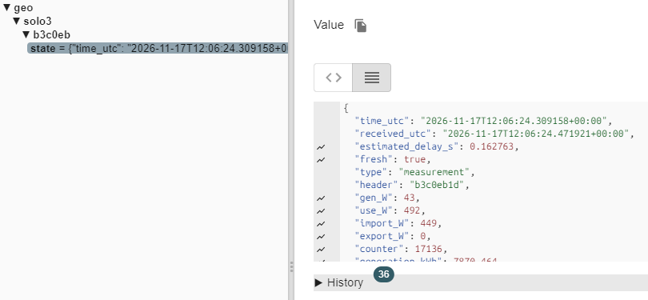

# Geo Solo III / emlite EMC1.w RTL-SDR decoder

An experimental, receive-only Python decoder for measurements transmitted by a Geo/ASL radio module attached to an emlite EMC1.w meter used with a Solo III system.

It receives locally at 868 MHz without the Geo cloud, hub, or IHD being powered on. No pairing code is required for the observed measurement broadcasts.

## Status and compatibility

Tested on one installation using Windows and a Nooelec NESDR Mini 2 (RTL2832U/R820T2). Instantaneous values matched the Solo III IHD during load tests, and the generation counter matched the physical meter register. Transmission continued with both hub and IHD off.

A Raspberry Pi 4B with an R828D-based RTL-SDR also recorded valid measurement frames. Firmware versions may differ. Verify the selected radio ID against the physical meter or Solo III IHD.

## Find your meter ID

Install the dependencies using the Windows or Linux instructions below first. Use the decoder's discovery mode to find the ID directly from its CRC-valid measurement frames.

1. Close other SDR applications and place the antenna near the meter's radio module. On a Pi running the MQTT user service, stop it to free the receiver:

   ```sh
   systemctl --user stop geo-solo3-mqtt.service
   ```

2. From the repository directory, run discovery with your virtual environment's Python:

   ```sh
   .venv/bin/python cli.py --discover --format pretty --seconds 120
   ```

   On Windows, use `.\.venv\Scripts\python.exe` in place of `.venv/bin/python`. If required, add `--library` with your library path.

3. Look for repeated output with `PAYLOAD 29 B`, `FRAME 35 B`, and `CRC OK`. For example:

   ```text
   2026-11-19T19:26:17.686494+00:00  HEADER e980b81d  PAYLOAD 29 B  FRAME 35 B  CRC OK
   ```

   The first six header digits, `E980B8`, are the candidate three-byte radio ID. The final `1d` is the payload length. Pass the six-digit ID to measurement mode and compare the generation counter with the physical meter or instantaneous readings with the Solo III IHD:

   ```sh
   .venv/bin/python cli.py --meter-id E980B8 --seconds 60
   ```

Pairing the Solo III display with the meter can change this ID. One installation changed from `B3C0EB` to `E980B8` after pairing. If readings stop after pairing, repeat discovery and update `--meter-id` in the service's `ExecStart` command:

```sh
nano "${XDG_CONFIG_HOME:-$HOME/.config}/systemd/user/geo-solo3-mqtt.service"
systemctl --user daemon-reload
systemctl --user restart geo-solo3-mqtt.service
```

The MQTT topic is configured separately from the radio ID. When updating an existing service after pairing, keep its topic, such as `geo/solo3/b3c0eb/state`, so the configured Home Assistant sensors continue receiving readings.

`rtl_433 -f 868M -T 120` can sometimes show a matching `GEO-minimCT` ID, but it may show only unrelated devices even while this decoder receives Solo III frames. Use the discovery command above to identify the current measurement header.

`--meter-id` accepts uppercase and lowercase hex and selects the 29-byte Solo III payload. Running without a selection uses the original ID `1D4086`.

## Requirements

- Python 3.10 or newer.
- RTL-SDR receiver covering 868 MHz and a suitable antenna.
- NumPy and a compatible librtlsdr installation.
- Exclusive access to the receiver: close SDR Console and other SDR applications.

## Windows quick start

Install WinUSB for the receiver's **Interface 0** using Zadig. Check the selected device carefully. Install SDR Console V3, whose installation includes the RTL-SDR DLL and dependencies used by the tested setup.

In PowerShell, from this project directory:

```powershell
py -m venv .venv
.\.venv\Scripts\python.exe -m pip install -r requirements.txt
.\.venv\Scripts\python.exe cli.py --seconds 60
```

The default library directory is `C:\Program Files\SDR-Radio.com (V3)`. For a different installation:

```powershell
.\.venv\Scripts\python.exe cli.py --library "C:\path\to\dll-directory" --seconds 86400
```

Python and the native DLL must use matching architectures (normally 64-bit). A DLL-loading error can also mean a dependency is missing.

## Linux

Install your distribution's librtlsdr package and Python virtual environment support, then:

```sh
python3 -m venv .venv
.venv/bin/pip install -r requirements.txt
.venv/bin/python cli.py --seconds 60
```

USB permissions and the DVB kernel driver may require distribution-specific configuration. Follow your RTL-SDR supplier's instructions. If automatic library discovery fails, pass the full path to the shared library with `--library`.

## Output and operation

Standard output contains one JSON object per fresh decoded measurement; diagnostics go to standard error. Fields include `gen_W`, `use_W`, `import_W`, `export_W`, generation kWh, inferred cumulative counters, UTC timestamps and frame counter.

Import/export power is calculated from USE minus GEN. Cumulative usage/import/export labels are inferred; generation is independently checked against the physical meter. See [protocol notes](docs/protocol.md).

Use `--device 1` to select another receiver index. Press Ctrl+C to stop. The default duration is 24 hours; use an appropriate larger `--seconds` value or a service manager for longer operation. Automatic restart is the responsibility of that service manager.

No files or raw I/Q recordings are saved automatically. Redirecting output to a file creates an ever-growing log; configure rotation if you do so. `--include-frame` adds frame hex for investigation.

Reception is fixed at 868 MHz, 2.4 MS/s and 28 dB gain. Poor antenna placement, interference or different radio variants may prevent decoding. A quiet console means no fresh matching CRC-valid packets were found; it does not prove a hardware fault.

Measurement mode drops CRC-valid 29-byte payloads that start with `00 XX 40 50`, where `XX` is a variable byte. In two logged frames, the extra leading zero shifted the measurement fields by one byte and caused large spikes in the MQTT energy readings. The byte before `40 50` changed from `47` to `48` after pairing on one installation; the filter covers either value and other values of that byte. Use `--discover --include-frame` to inspect those frames as raw packets.

## Home Assistant

Publish the decoder's JSON readings from a Raspberry Pi to the MQTT broker used by Home Assistant. The examples use meter ID `B3C0EB`, broker `192.168.50.161:1883`, and MQTT username `mqtt`. Replace those values for your setup. If you change the MQTT topic, use the same topic in the publisher, MQTT Explorer, and Home Assistant.

### Set up the MQTT broker

Use an existing broker or install and start the Mosquitto broker app on Home Assistant OS. Create MQTT credentials for the Pi using your broker's authentication settings. In Home Assistant, add or configure the MQTT integration to use that broker. The Pi and MQTT Explorer connect to the broker's LAN address. [Home Assistant MQTT setup](https://www.home-assistant.io/integrations/mqtt/#setting-up-a-broker) · [Mosquitto broker app configuration](https://github.com/home-assistant/apps/blob/master/mosquitto/DOCS.md)

### Install the Raspberry Pi tools and test publishing

Clone this repository to `~/geo-solo-iii-emc1w-rtl-sdr-decoder`, plug in the RTL-SDR, and install the dependencies on Raspberry Pi OS. Use the [meter ID steps](#find-your-meter-id) if you need to find your ID. Stop `rtl_433` or any other SDR application before starting the decoder.

```sh
sudo apt update
sudo apt install python3-venv rtl-sdr mosquitto-clients
cd ~/geo-solo-iii-emc1w-rtl-sdr-decoder
python3 -m venv .venv
.venv/bin/python -m pip install -r requirements.txt
```

Create a private Mosquitto client config on the Pi. This keeps the password out of the repository and command line. [Mosquitto publisher configuration](https://mosquitto.org/man/mosquitto_pub-1.html)

```sh
install -d -m 700 ~/.config/geo-solo3
touch ~/.config/geo-solo3/mosquitto_pub
chmod 600 ~/.config/geo-solo3/mosquitto_pub
nano ~/.config/geo-solo3/mosquitto_pub
```

Save these lines in the file and replace `YOUR_MQTT_PASSWORD` with the broker password:

```text
-u mqtt
-P YOUR_MQTT_PASSWORD
```

Run a 60-second test from the repository directory:

```sh
.venv/bin/python cli.py --meter-id B3C0EB --format json --seconds 60 \
  | XDG_CONFIG_HOME="$HOME/.config/geo-solo3" mosquitto_pub \
      -h 192.168.50.161 -p 1883 -t 'geo/solo3/b3c0eb/state' -q 1 -l
```

The publisher sends one JSON message per line. Decoder logs go to stderr. If automatic library discovery fails, add `--library /path/to/librtlsdr.so` to the decoder command here and in the service below.

### Verify messages in MQTT Explorer

Install MQTT Explorer on a computer that can reach the broker. Connect to the same broker address and port with valid MQTT credentials. Expand `geo → solo3 → b3c0eb → state` while the decoder is running. Check that the JSON contains `crc_ok: true` and that `time_utc` and `counter` advance. The screenshot shows a successfully received reading. [MQTT Explorer downloads](https://mqtt-explorer.com/)



### Configure Home Assistant sensors

Add the following to Home Assistant's `configuration.yaml`. If you already have an `mqtt:` section, add the entries to its `sensor:` list. Validate the configuration and restart Home Assistant. With `expire_after: 30`, readings become unavailable after 30 seconds without a message. The publisher leaves MQTT retain off so the broker does not replay a stale reading on restart. [Home Assistant MQTT sensor configuration](https://www.home-assistant.io/integrations/sensor.mqtt/)

```yaml
mqtt:
  sensor:
    - name: "Geo Solar Power"
      unique_id: geo_solo3_b3c0eb_gen_w
      state_topic: "geo/solo3/b3c0eb/state"
      value_template: "{{ value_json.gen_W }}"
      device_class: power
      state_class: measurement
      unit_of_measurement: "W"
      expire_after: 30

    - name: "Geo Household Power"
      unique_id: geo_solo3_b3c0eb_use_w
      state_topic: "geo/solo3/b3c0eb/state"
      value_template: "{{ value_json.use_W }}"
      device_class: power
      state_class: measurement
      unit_of_measurement: "W"
      expire_after: 30

    - name: "Geo Grid Import Power"
      unique_id: geo_solo3_b3c0eb_import_w
      state_topic: "geo/solo3/b3c0eb/state"
      value_template: "{{ value_json.import_W }}"
      device_class: power
      state_class: measurement
      unit_of_measurement: "W"
      expire_after: 30

    - name: "Geo Grid Export Power"
      unique_id: geo_solo3_b3c0eb_export_w
      state_topic: "geo/solo3/b3c0eb/state"
      value_template: "{{ value_json.export_W }}"
      device_class: power
      state_class: measurement
      unit_of_measurement: "W"
      expire_after: 30

    - name: "Geo Solar Energy"
      unique_id: geo_solo3_b3c0eb_generation_kwh
      state_topic: "geo/solo3/b3c0eb/state"
      value_template: "{{ value_json.generation_kWh }}"
      device_class: energy
      state_class: total_increasing
      unit_of_measurement: "kWh"
      expire_after: 30

    - name: "Geo Household Energy"
      unique_id: geo_solo3_b3c0eb_usage_kwh
      state_topic: "geo/solo3/b3c0eb/state"
      value_template: "{{ value_json.inferred_usage_kWh }}"
      device_class: energy
      state_class: total_increasing
      unit_of_measurement: "kWh"
      expire_after: 30

    - name: "Geo Grid Import Energy"
      unique_id: geo_solo3_b3c0eb_import_kwh
      state_topic: "geo/solo3/b3c0eb/state"
      value_template: "{{ value_json.inferred_import_kWh }}"
      device_class: energy
      state_class: total_increasing
      unit_of_measurement: "kWh"
      expire_after: 30

    - name: "Geo Grid Export Energy"
      unique_id: geo_solo3_b3c0eb_export_kwh
      state_topic: "geo/solo3/b3c0eb/state"
      value_template: "{{ value_json.inferred_export_kWh }}"
      device_class: energy
      state_class: total_increasing
      unit_of_measurement: "kWh"
      expire_after: 30
```

Compare **Geo Solar Energy** with the physical meter and check that changes in the inferred **Geo Grid Import Energy** and **Geo Grid Export Energy** match their respective grid meter registers before adding them to the Energy dashboard. [Home Assistant Energy dashboard sensor requirements](https://www.home-assistant.io/docs/energy/faq/#the-sensor-doesnt-appear-in-the-selection-list)

For daily totals, create one **Utility Meter** helper per energy sensor and set the reset cycle to **Daily**. For example, create **Geo Household Energy Today** with **Geo Household Energy** as its input. Its source is inferred, so check that the changes are consistent with household consumption. Leave **Delta values** off so the helpers add the differences between cumulative readings. Turn **Periodically resetting** off for lifetime counters that never reset. [Home Assistant Utility Meter documentation](https://www.home-assistant.io/integrations/utility_meter/)

### Run continuously with systemd

From the Pi account that runs the decoder, create the user service file:

```sh
mkdir -p "${XDG_CONFIG_HOME:-$HOME/.config}/systemd/user"
nano "${XDG_CONFIG_HOME:-$HOME/.config}/systemd/user/geo-solo3-mqtt.service"
```

Paste the unit below. Systemd runs it as that account and expands `%h` to its home directory. Adjust `WorkingDirectory` if you cloned the repository elsewhere. The service restarts after the decoder's default 24-hour run or if the publisher exits. [systemd unit specifiers](https://www.freedesktop.org/software/systemd/man/latest/systemd.unit.html#Specifiers)

```ini
[Unit]
Description=Geo Solo III meter to MQTT

[Service]
Type=simple
WorkingDirectory=%h/geo-solo-iii-emc1w-rtl-sdr-decoder
Environment=XDG_CONFIG_HOME=%h/.config/geo-solo3
ExecStart=/bin/bash -c 'exec /usr/bin/mosquitto_pub -h 192.168.50.161 -p 1883 -t geo/solo3/b3c0eb/state -q 1 -l < <(exec .venv/bin/python cli.py --meter-id B3C0EB --format json)'
Restart=always
RestartSec=5

[Install]
WantedBy=default.target
```

Stop the test pipeline and any other program using the SDR. If you previously installed a system-wide `geo-solo3-mqtt.service`, stop and disable it with `sudo systemctl disable --now geo-solo3-mqtt.service` so both services do not try to open the same receiver.

Enable lingering for your account so its services start at boot and keep running after logout. Then enable the user service and follow its logs. [loginctl documentation](https://www.freedesktop.org/software/systemd/man/latest/loginctl.html)

```sh
sudo loginctl enable-linger "$(id -un)"
systemctl --user daemon-reload
systemctl --user enable --now geo-solo3-mqtt.service
journalctl --user -u geo-solo3-mqtt.service -f
```

If `journalctl --user` reports `No journal files were found`, check the service status and read its messages from the system journal. The second command filters by the current account and user unit, and works with volatile journal storage. [journalctl documentation](https://www.freedesktop.org/software/systemd/man/latest/journalctl.html)

```sh
systemctl --user status geo-solo3-mqtt.service --no-pager
sudo journalctl -b -f _SYSTEMD_USER_UNIT=geo-solo3-mqtt.service _UID="$(id -u)"
```

Example `systemctl --user status` output from a Raspberry Pi 4B, with the home directory shown as `~`:

```text
● geo-solo3-mqtt.service - Geo Solo III meter to MQTT
     Loaded: loaded (~/.config/systemd/user/geo-solo3-mqtt.service; enabled; preset: enabled)
     Active: active (running) since Tue 2026-11-17 12:27:58 GMT; 1min 41s ago
 Invocation: db946668a0d84fb0a859f283b794c896
   Main PID: 2709 (mosquitto_pub)
      Tasks: 8 (limit: 3960)
        CPU: 53.291s
     CGroup: /user.slice/user-1000.slice/user@1000.service/app.slice/geo-solo3-mqtt.service
             ├─2709 /usr/bin/mosquitto_pub -h 192.168.50.161 -p 1883 -t geo/solo3/b3c0eb/state -q 1 -l
             └─2711 .venv/bin/python cli.py --meter-id B3C0EB --format json

Nov 17 12:27:58 raspberrypi4b systemd[1067]: Started geo-solo3-mqtt.service - Geo Solo III meter to MQTT.
Nov 17 12:27:58 raspberrypi4b bash[2711]: WARNING:root:Experimental layout assumption: verify values against your meter/IHD
Nov 17 12:27:58 raspberrypi4b bash[2711]: Found Rafael Micro R828D tuner
Nov 17 12:27:59 raspberrypi4b bash[2711]: Disabled direct sampling mode
Nov 17 12:27:59 raspberrypi4b bash[2711]: [R82XX] PLL not locked!
Nov 17 12:27:59 raspberrypi4b bash[2711]: [R82XX] PLL not locked!
Nov 17 12:27:59 raspberrypi4b bash[2711]: INFO:geo_decoder:Geo radio receiver started at 2026-11-17T12:27:59.401024+00:00
```

Example output from the filtered system journal:

```text
Nov 17 12:27:58 raspberrypi4b bash[2711]: WARNING:root:Experimental layout assumption: verify values against your meter/IHD
Nov 17 12:27:58 raspberrypi4b bash[2711]: Found Rafael Micro R828D tuner
Nov 17 12:27:59 raspberrypi4b bash[2711]: Disabled direct sampling mode
Nov 17 12:27:59 raspberrypi4b bash[2711]: [R82XX] PLL not locked!
Nov 17 12:27:59 raspberrypi4b bash[2711]: [R82XX] PLL not locked!
Nov 17 12:27:59 raspberrypi4b bash[2711]: INFO:geo_decoder:Geo radio receiver started at 2026-11-17T12:27:59.401024+00:00
```

The journal shows the receiver starting. Use MQTT Explorer or Home Assistant's MQTT topic listener to confirm delivery. The startup PLL messages appeared on this working setup. Press **Ctrl+C** to leave the log view while the service keeps running.


## Tests

```sh
python -m unittest discover -s tests -v
```

Tests cover a known CRC vector, synthetic field mapping, and rejection of the observed shifted payload in measurement mode. Live reception can be checked separately with an RTL-SDR.

## Scope

This project does not implement cloud emulation, RF transmission, pairing, Home Assistant discovery or dashboard integration. It requires no account credentials. Never open a mains meter or disturb its seals to use this software.

## Contributing

Report OS, Python version, receiver model, library version and receiver errors. Redact device identifiers and household information before sharing captures. Protocol variants and independent hardware confirmations are particularly useful.

This is an independent reverse-engineering project, unaffiliated with Geo, ASL, emlite or Nooelec.

## License

No license has been selected yet. The repository owner should add their chosen license before publication; downloading source alone does not grant redistribution rights.

## Discovery and readable output

Use `python cli.py --format pretty --seconds 60` for readable terminal output.
Use `python cli.py --discover --format pretty --seconds 180` to inspect other
CRC-valid Geo headers without interpreting them as measurements.
JSON remains the default. With `--header`, custom measurement headers require `--assume-solo-layout`. The `--meter-id` option selects that layout directly.
See [Discovery, selection and output](docs/discovery-and-output.md) for Windows
and Linux commands, field meanings, custom header examples and troubleshooting.

